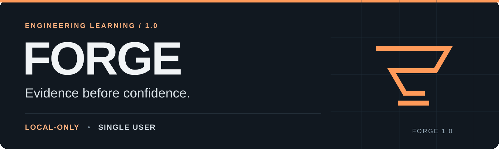
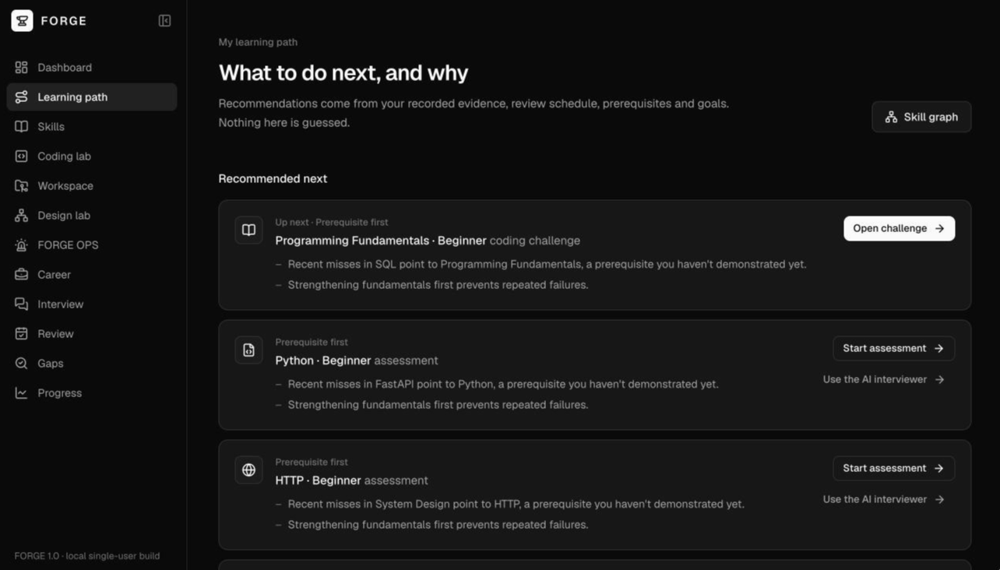
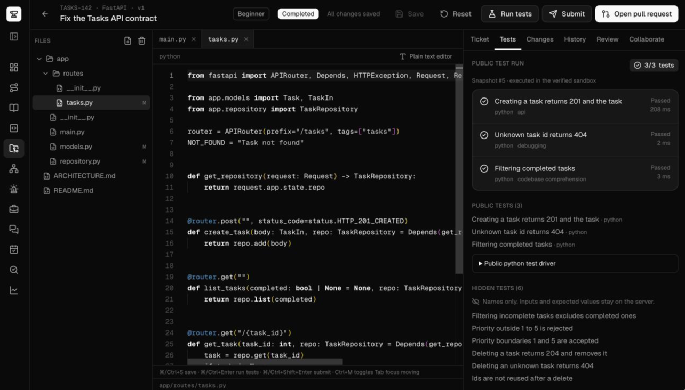
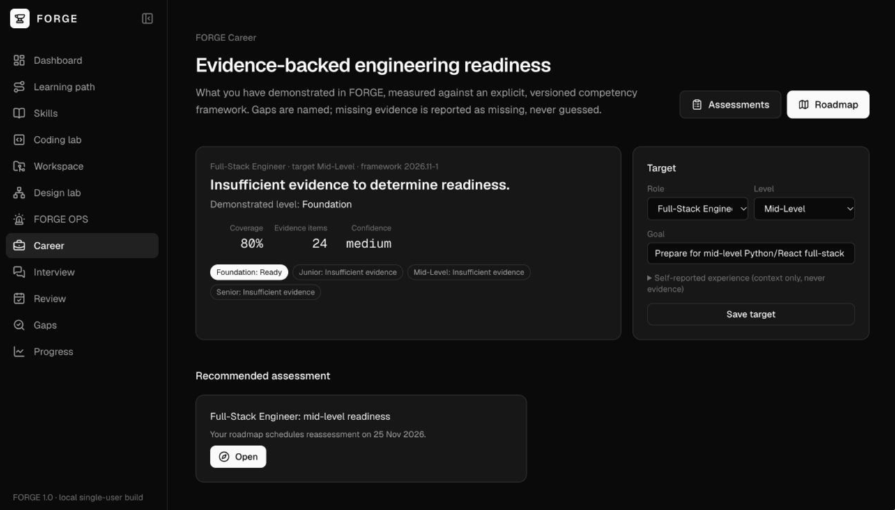

  

  <strong>Practice engineering. Show your reasoning. Build evidence.</strong> 
  An engineering learning platform for one learner on one local machine.

  <a href="#inside-forge">Explore</a> ·
  <a href="#screenshots">Screenshots</a> ·
  <a href="#local-setup">Local setup</a> ·
  <a href="docs/ARCHITECTURE.md">Architecture</a> ·
  <a href="CONTRIBUTING.md">Contribute</a>

> [!WARNING]
> **LOCAL-ONLY · SINGLE USER.** FORGE 1.0 has **no authentication**. An anonymous browser cookie identifies the learner; it does not establish a secure account. Keep the web app, API and database bound to loopback (`127.0.0.1`). **Do not expose FORGE to a shared network or the internet**, including through tunnels, proxies or public demos. Its runc container isolation is unsuitable for untrusted multi-tenant code execution. Run **one API process** because the global AI call budget is per process. Read [SECURITY.md](SECURITY.md) before running code.

## Why FORGE

FORGE brings diagnostics, interviews, practical exercises and reflection into one local learning environment. Its `mastery-v1.5` engine explains what evidence is missing and supports an adaptive path with spaced review, knowledge gaps and goals.

The distinction matters: written assessment responses are **saved, not scored**. Written reasoning is evaluated in the AI interviewer, and AI reviews remain advisory. AI never decides correctness, approval or verified mastery.

<table>
  <tr>
    <td align="center"><strong>40</strong> assessment questions</td>
    <td align="center"><strong>19</strong> coding challenges</td>
    <td align="center"><strong>8</strong> incident scenarios</td>
    <td align="center"><strong>3</strong> multi-file projects</td>
  </tr>
</table>

Counts and release claims below come from the [FORGE 1.0 release report](docs/release/RELEASE_NOTES_1.0.md).

## Inside FORGE

| Area | What 1.0 includes |
| --- | --- |
| **Assessments** | 40 questions across 8 skills, with rubrics, misconceptions and resources. Across formats, 10 of 13 curriculum skills are assessable; Programming Fundamentals and Security are assessed only through coding challenges. |
| **AI interviewer** | Four modes, validated and quote-verified evaluations, and targeted follow-ups. Supports Ollama Cloud or an OpenAI-compatible endpoint. |
| **Adaptive learning** | `mastery-v1.5`, evidence gaps, goals and spaced review. |
| **Coding lab** | 19 Python, JavaScript and TypeScript challenges, hidden tests in a self-verifying container sandbox, and advisory AI review. |
| **System design lab** | AI architecture review and failure drills. |
| **FORGE OPS** | 8 incident simulations with deterministic outcomes and advisory AI root-cause-analysis review. |
| **FORGE Career** | A versioned competency framework, assessments, roadmap, job description analysis and evidence-backed readiness reporting. |
| **FORGE Workspace** | Three projects: a FastAPI bug fix, a full-stack feature and PostgreSQL concurrency. Includes a browser IDE, simulated pull requests, four AI senior-reviewer modes and collaboration exercises. |

## Screenshots

Real captures of FORGE 1.0 running locally (4 November 2026) with a sample learner. No production data.

<table>
  <tr>
    <td width="50%"></td>
    <td width="50%"></td>
  </tr>
  <tr>
    <td><strong>Workspace</strong> · A multi-file bug-fix project. The public tests ran in the verified Docker sandbox; hidden test inputs stay on the server.</td>
    <td><strong>Career readiness</strong> · Coverage, evidence and confidence for a sample learner. Missing evidence is reported as missing.</td>
  </tr>
</table>

## Local setup

The local checkout uses **Next.js/React**, **FastAPI**, **SQLAlchemy/Alembic**, **PostgreSQL** and a separate execution worker. The migration, seed, test, verification and build commands were run during the 1.0 release audit (see [AUDIT_1.0.md](docs/release/AUDIT_1.0.md)); a from-scratch install on a fresh clone has not yet been rehearsed.

1. Obtain the source and open its root, containing `api/`, `web/` and `docker-compose.yml`.
2. Follow [DEVELOPMENT.md](docs/DEVELOPMENT.md) to start PostgreSQL, create private environment files, install dependencies, migrate and seed the database, and build the web app.
3. Start one API process and the web app on loopback. Open [http://127.0.0.1:3000](http://127.0.0.1:3000) on the same machine.
4. Configure an AI provider only if wanted. Enable real code execution only after reviewing the container boundary, building the images and running the documented verification steps.

AI and real sandbox execution default to **disabled** in the checked-in configuration examples. Cloud AI, when configured, uses a remote provider; “local-only” describes application access and does not mean all processing stays on your computer.

**Upgrading an existing installation?** Back up the database first. The release reports migration head `0008`, with no schema changes since Milestone 9. Run the migration and seed commands from `api/`, then rebuild from `web/`; see the [upgrade steps](docs/DEVELOPMENT.md#upgrading).

## Architecture

The browser reaches the local Next.js server, which makes server-side requests to the local FastAPI API. PostgreSQL stores application state. A separate worker handles code-execution jobs in containers. Configured AI providers supply advisory evaluations and reviews.

See [ARCHITECTURE.md](docs/ARCHITECTURE.md) for component paths, execution flow and trust boundaries.

## Realistic limits

- **Coverage is finite.** DevOps, Distributed Systems and Senior Engineering Practices have no assessments. The workspace library contains three projects.
- **Written assessment responses are unscored.** AI-interview reasoning evaluation is a separate activity.
- **Sandbox TypeScript is not type-checked.** Types are stripped. Workspace tests do not render React components.
- **AI can be wrong.** Reviews are advisory, and lexical leak filters can miss paraphrased fixes.
- **Validation is incomplete.** Browser-automated end-to-end tests, Content-Security-Policy, a dependency vulnerability scan and a screen-reader audit were not completed in the release report.
- **Real-model coverage is partial.** The release smoke-tested interviewer, coding review and workspace review with real models. Design-lab, OPS and career AI calls used a fake provider only.

Read the full [limitations and validation scope](docs/LIMITATIONS.md). The career report is a learning aid; the release report establishes no guarantee of hiring outcomes or comprehensive engineering readiness.

## Contributing

Contribution ideas include curriculum coverage, practical challenges, regression tests, accessibility and documentation. These are opportunities for discussion, not a promised roadmap. Start with [CONTRIBUTING.md](CONTRIBUTING.md), follow the [Code of Conduct](CODE_OF_CONDUCT.md), and use the issue and pull request templates.

Report vulnerabilities through the private route described in [SECURITY.md](SECURITY.md), rather than a public issue.

## Documentation

- [Local development and testing](docs/DEVELOPMENT.md)
- [Architecture and trust boundaries](docs/ARCHITECTURE.md)
- [Limitations and release validation](docs/LIMITATIONS.md)
- [Screenshot capture and replacement](docs/SCREENSHOTS.md)
- [Secrets and Git review](docs/SECRETS_CHECKLIST.md)
- [1.0 release notes](docs/release/RELEASE_NOTES_1.0.md)
- [Deployment and operations (environment variables, backups, rollback)](docs/release/DEPLOYMENT.md)
- [1.0 release audit](docs/release/AUDIT_1.0.md)
- Module guides: [interviewer](docs/interviewer.md), [mastery](docs/mastery.md), [coding lab](docs/coding-lab.md), [system design lab](docs/system-design-lab.md), [FORGE OPS](docs/forge-ops.md), [career](docs/career.md), [workspace](docs/workspace.md)
- [Maintainer launch checklist](docs/release/LAUNCH_CHECKLIST.md)

## License

FORGE is open source under the [MIT License](LICENSE). You can use, copy, modify and share it, including commercially, as long as you keep the copyright and license notice. It comes with no warranty. Third-party material included in the repository is listed in [THIRD_PARTY_NOTICES.md](THIRD_PARTY_NOTICES.md).
